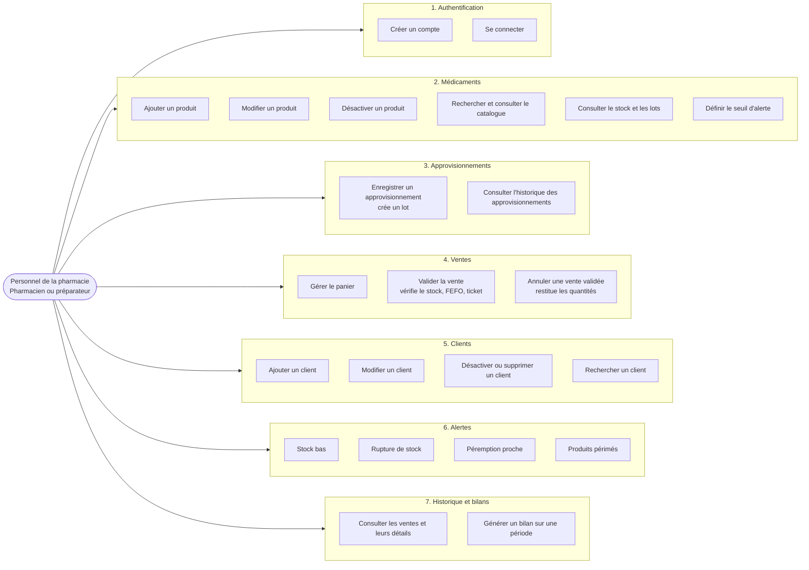
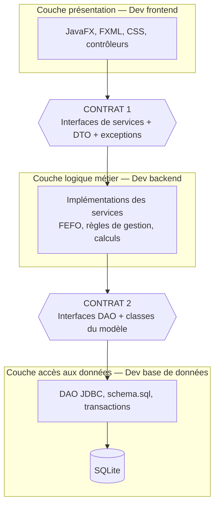
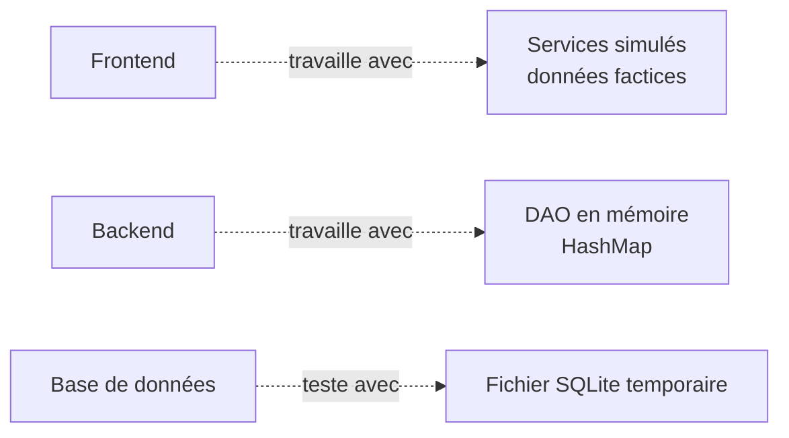
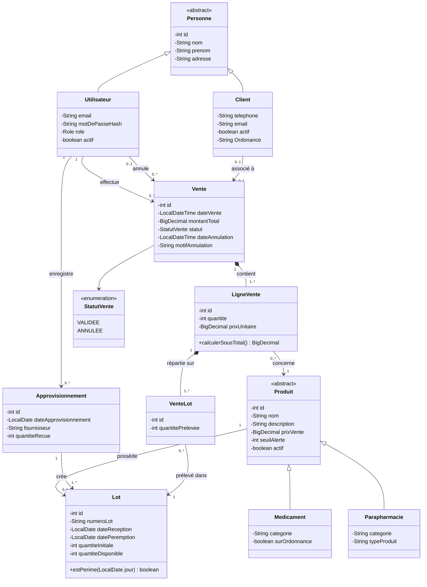
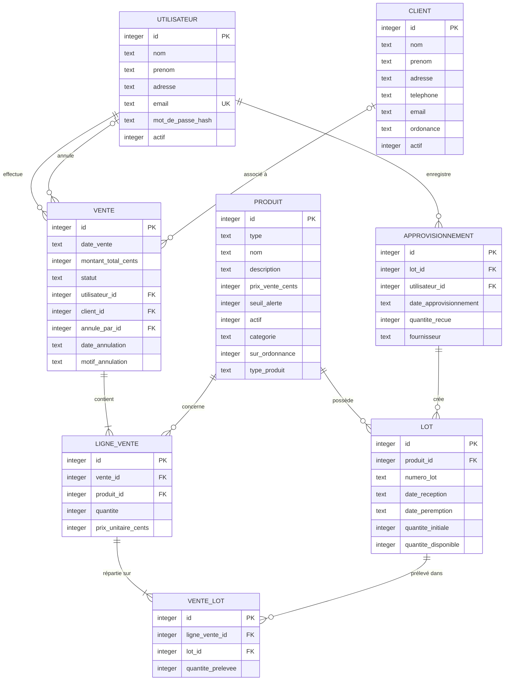
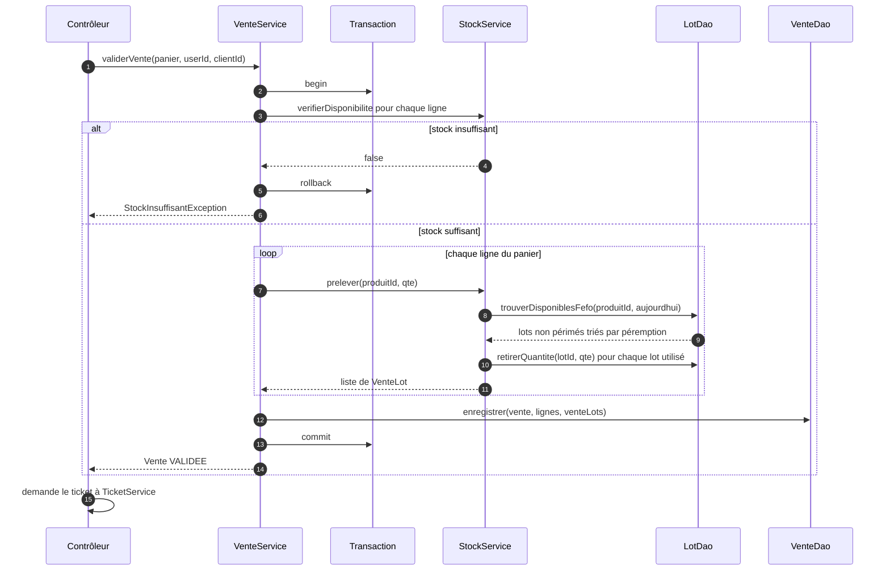
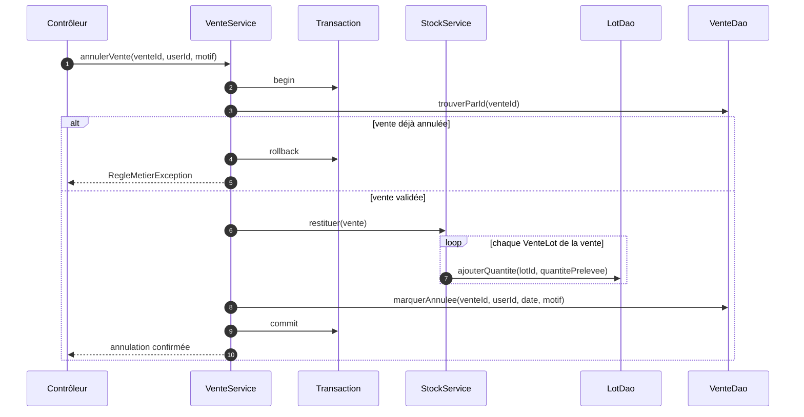
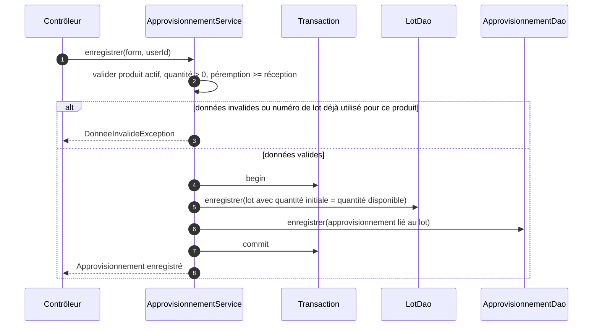
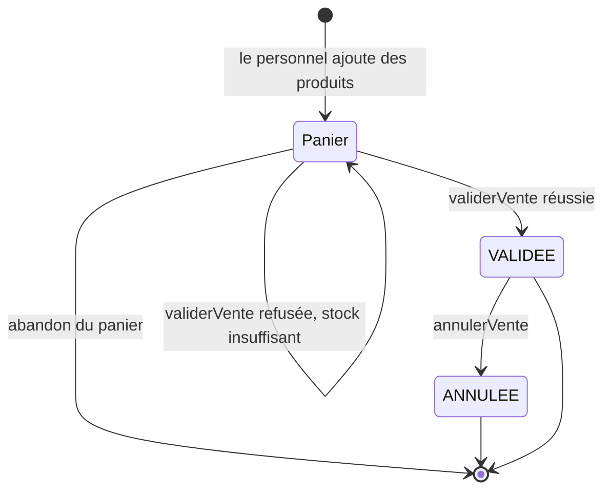

# Document de conception — Application de gestion de pharmacie (v2)

> Version 2.0 — 7 novembre 2026
> Application desktop Java / JavaFX / SQLite
> Cette version corrige et complète la v1 (cas d'utilisation, diagramme de classes, architecture) afin que **frontend, backend et base de données** puissent être développés **en parallèle** sans ambiguïté.

**Légende des marqueurs utilisés dans ce document**

- **[DÉCIDÉ]** : choix retenu dans cette version.
- **[À CONFIRMER]** : hypothèse raisonnable, mais l'équipe doit la valider avant le gel des contrats.
- **[PROPOSITION]** : suggestion technique (noms, signatures) que l'équipe peut renommer librement, tant qu'elle est gelée ensuite.

---

## Sommaire

1. Objectif et périmètre
2. Glossaire métier
3. Règles de gestion
4. Acteurs et cas d'utilisation
5. Architecture et contrats
6. Modèle du domaine
7. Contrat des services
8. Contrat des DAO
9. Base de données
10. Diagrammes de séquence
11. Cycle de vie d'une vente
12. Alertes
13. Gestion des erreurs
14. Plan de développement en parallèle
15. Scénarios de test de référence
16. Journal des corrections par rapport à la v1
17. Points ouverts

---

## 1. Objectif et périmètre

L'application permet au personnel d'une pharmacie (pharmaciens et préparateurs, **mêmes droits d'accès**) de :

- gérer le catalogue des médicaments ;
- enregistrer les approvisionnements (entrées de stock par lot) ;
- vendre (panier, vérification du stock, déduction FEFO, ticket) et annuler une vente ;
- gérer les clients ;
- surveiller le stock et les péremptions (alertes) ;
- consulter l'historique des ventes et générer des bilans.

Chaque opération est rattachée à l'utilisateur qui l'a réalisée (traçabilité).

**Hors périmètre** (décision de la v1, conservée) : remboursements et assurances, registres réglementaires, gestion avancée des fournisseurs, gestion de plusieurs pharmacies.

---

## 2. Glossaire métier

| Terme | Définition |
|---|---|
| **Produit** | Entrée du catalogue (ex. « Paracétamol 500 mg, boîte de 16 »). Un produit est soit un `Medicament`, soit un article de `Parapharmacie`. |
| **Lot** | Une livraison précise d'**un seul** produit, identifiée par un numéro de lot, avec sa date de réception et sa **date de péremption**. Un produit a plusieurs lots ; un lot appartient à un seul produit. |
| **Stock d'un produit** | Somme des quantités disponibles de ses lots **non périmés**. Le stock n'est **jamais stocké** à part : il est calculé. |
| **Approvisionnement** | Enregistrement d'une réception. Dans cette version, **un approvisionnement crée exactement un lot**. |
| **FEFO** | *First Expired, First Out* : lors d'une vente, on prélève d'abord dans le lot dont la date de péremption est la plus proche. |
| **Panier** | Liste temporaire de produits et quantités en cours de saisie. Il n'existe qu'en mémoire (pas en base). |
| **Vente** | Opération validée, avec ses lignes, son total, son statut (`VALIDEE` ou `ANNULEE`) et l'utilisateur responsable. |
| **Ligne de vente** | Un produit, une quantité et le **prix unitaire au moment de la vente**. |
| **VenteLot** | Trace de la quantité prélevée dans chaque lot pour satisfaire une ligne de vente. Indispensable pour FEFO et pour l'annulation. |
| **Annulation** | Changement de statut d'une vente validée vers `ANNULEE`, avec restitution des quantités aux lots d'origine. La vente n'est jamais supprimée. |
| **Désactivation** | Un produit, un client ou un utilisateur n'est jamais supprimé s'il a servi dans une opération : il est marqué inactif. |
| **Seuil d'alerte** | Quantité minimale propre à chaque produit ; en dessous (ou égal), une alerte « stock bas » apparaît. |

---

## 3. Règles de gestion

Chaque règle porte un identifiant pour pouvoir être citée dans le code, les tests et les revues.

### Comptes et utilisateurs

- **RG-01** — Un utilisateur se connecte avec son e-mail et son mot de passe. Le mot de passe est stocké **haché avec un sel** (jamais en clair). [DÉCIDÉ]
- **RG-02** — Un utilisateur inactif ne peut pas se connecter. [DÉCIDÉ]
- **RG-03** — Le rôle (`PHARMACIEN` ou `PREPARATEUR`) est informatif : les deux rôles ont les mêmes droits. [DÉCIDÉ, conforme au cahier des charges]
- **RG-04** — Toute vente, annulation et approvisionnement enregistre l'utilisateur responsable. [DÉCIDÉ]

### Produits

- **RG-10** — Un produit désactivé reste visible dans l'historique mais ne peut plus être ajouté à un panier ni recevoir de nouvel approvisionnement. [DÉCIDÉ]
- **RG-11** — Le prix de vente est positif ou nul. Le modifier n'affecte pas les ventes passées (voir RG-33). [DÉCIDÉ]
- **RG-12** — Le seuil d'alerte est un entier supérieur ou égal à 0. [DÉCIDÉ]

### Approvisionnements et lots

- **RG-20** — Un approvisionnement concerne un ou plusieur produit actif et crée un ou plusieur lot. [DÉCIDÉ]
- **RG-21** — La quantité reçue est strictement positive. [DÉCIDÉ]
- **RG-22** — La date de péremption est supérieure ou égale à la date de réception. [DÉCIDÉ]
- **RG-23** — Le couple (produit, numéro de lot) est unique. [PROPOSITION : à confirmer si le numéro doit être unique dans toute la pharmacie ou seulement par produit]
- **RG-24** — La quantité disponible d'un lot est toujours comprise entre 0 et sa quantité initiale. [DÉCIDÉ]
- **RG-25** — Le fournisseur est facultatif à la saisie ; il s'agit d'une entité minimale (nom, téléphone). [DÉCIDÉ, voir §17 question 1]

### Ventes

- **RG-30** — Une vente contient au moins une ligne. [DÉCIDÉ]
- **RG-31** — La quantité demandée d'un produit ne peut pas dépasser son stock vendable, calculé sur les lots non périmés. [DÉCIDÉ]
- **RG-32** — La quantité est prélevée selon FEFO : lots non périmés, triés par date de péremption croissante. Une ligne peut consommer plusieurs lots. [DÉCIDÉ]
- **RG-33** — Chaque ligne conserve le **prix unitaire du jour de la vente**. [DÉCIDÉ]
- **RG-34** — Le client est facultatif (vente anonyme possible). [DÉCIDÉ]
- **RG-35** — La validation d'une vente est **atomique** : soit tout est enregistré (vente, lignes, VenteLot, mise à jour des lots), soit rien. [DÉCIDÉ]
- **RG-36** — Un ticket est généré après validation. Format à définir (voir §17). [À CONFIRMER]

### Annulation

- **RG-40** — Seule une vente au statut `VALIDEE` peut être annulée, une seule fois. [DÉCIDÉ]
- **RG-41** — L'annulation restitue chaque quantité au lot d'origine, d'après les `VenteLot`. [DÉCIDÉ]
- **RG-42** — L'annulation enregistre l'utilisateur, la date et un motif (facultatif). La vente reste dans l'historique. [DÉCIDÉ]
- **RG-43** — L'annulation est atomique (comme RG-35). [DÉCIDÉ]

### Clients

- **RG-50** — Un client est désactivé, pas supprimé, dès qu'il est lié à au moins une vente. La suppression physique n'est permise que pour un client sans aucune vente. [DÉCIDÉ]

### Péremption et alertes

- **RG-60** — Un lot est **périmé** si sa date de péremption est strictement antérieure à la date du jour. Un lot périmé n'est jamais vendu. [À CONFIRMER : le dernier jour de validité compte-t-il comme encore vendable ?]
- **RG-61** — Un lot est « **proche de la péremption** » si son stock est supérieur à 0, qu'il n'est pas périmé et que sa péremption est dans les *N* prochains jours. *N* est un **paramètre de configuration**. [À CONFIRMER : valeur par défaut, par exemple 30, 60 ou 90 jours]
- **RG-62** — **Stock bas** : stock du produit > 0 et ≤ seuil d'alerte. **Rupture** : stock = 0. [DÉCIDÉ]
- **RG-63** — Les alertes sont **calculées à la demande** à partir des lots et des produits. Elles ne sont pas stockées. [DÉCIDÉ]
- **RG-64** — Les alertes de stock bas et de rupture ne concernent que les produits actifs. Les alertes de péremption concernent tous les lots dont la quantité est > 0. [PROPOSITION]

---

## 4. Acteurs et cas d'utilisation

Un seul acteur : le **personnel de la pharmacie** (pharmacien ou préparateur). Le diagramme corrige la v1 : ajout de l'authentification et de l'historique / bilans, et l'annulation est un cas d'utilisation distinct qui s'applique à une vente déjà validée (elle n'« étend » pas la validation).



Relations importantes entre cas d'utilisation :

| Cas d'utilisation | Relation | Cas lié |
|---|---|---|
| Valider la vente | inclut | Vérifier la disponibilité du stock, Mettre à jour les lots (FEFO), Générer un ticket |
| Annuler une vente validée | inclut | Restituer les quantités aux lots d'origine |
| Annuler une vente validée | précondition | La vente est au statut `VALIDEE` |
| Enregistrer un approvisionnement | inclut | Créer le lot |
| Consulter le stock d'un produit | utilise | Consulter les lots |

---

## 5. Architecture et contrats

Architecture en trois couches (inspirée de MVC), avec **deux contrats gelés** pendant un « sprint 0 ». Ces contrats sont ce qui permet le travail en parallèle.



Chaque développeur travaille contre une **doublure** de ce dont il dépend :



### Structure de packages [PROPOSITION]

```
com.pharmacie
├── model            entités du domaine et énumérations
├── dto              formulaires, Panier, Alerte, Bilan, Ticket
├── exception        exceptions métier
├── dao              interfaces DAO                   (CONTRAT 2)
├── dao.jdbc         implémentations JDBC / SQLite
├── dao.memoire      DAO en mémoire pour les tests du backend
├── service          interfaces de services           (CONTRAT 1)
├── service.impl     implémentations métier
├── service.simule   services factices pour le frontend
├── ui.controller    contrôleurs JavaFX
├── config           paramètres (jours d'alerte de péremption, etc.)
└── App.java         point d'entrée, assemblage des dépendances
src/main/resources
├── fxml             vues
├── css              styles
└── schema.sql       création de la base
```

### Conventions communes [DÉCIDÉ]

| Sujet | Convention |
|---|---|
| Argent en Java | `BigDecimal` (jamais `double`) |
| Argent en base | entier en centimes (`prix_vente_cents`) ; conversion faite **uniquement** dans les DAO |
| Dates | `LocalDate` et `LocalDateTime` en Java ; texte ISO-8601 en base (`2027-03-31`, `2026-11-07T11:30:00`) |
| Identifiants | `int`, clé auto-incrémentée par SQLite |
| Booléens en base | entier 0 ou 1 |
| Langue du code | français pour le domaine (cohérent avec ce document) [À CONFIRMER, voir §17] |
| Mots de passe | hachés avec sel, algorithme standard (par exemple PBKDF2, disponible dans le JDK) [À VALIDER par l'équipe dans la documentation officielle] |

---

## 6. Modèle du domaine

Les entités sont de **simples objets de données** : ni accès à la base, ni workflow. Les traitements (valider, annuler, calculer un stock) vivent dans les services.



Remarques :

- `Produit` ne contient **pas** de méthode `calculerStock()` : le stock se calcule dans `StockService`.
- `Lot` garde `quantiteInitiale` en plus de `quantiteDisponible` pour pouvoir vérifier la règle RG-24 et auditer.
- `Parapharmacie` est conservée comme dans la v1, mais le cahier des charges fonctionnel ne parle que de médicaments [À CONFIRMER, voir §17].
- Le panier n'est pas une entité du domaine (voir §7).

---

## 7. Contrat des services (Contrat 1)

Interfaces que le frontend appelle et que le backend implémente. Les noms et signatures sont des **propositions** à geler au sprint 0.

```mermaid
classDiagram
    direction TB

    class AuthService {
        <<interface>>
        +inscrire(NouvelUtilisateur u) Utilisateur
        +authentifier(String email, String mdp) Utilisateur
        +deconnecter() void
    }
    class ProduitService {
        <<interface>>
        +ajouter(ProduitForm f) Produit
        +modifier(int id, ProduitForm f) Produit
        +desactiver(int id) void
        +rechercher(String texte) List~Produit~
        +definirSeuil(int id, int seuil) void
    }
    class StockService {
        <<interface>>
        +calculerStock(int produitId) int
        +verifierDisponibilite(int produitId, int qte) boolean
        +prelever(int produitId, int qte) List~VenteLot~
        +restituer(Vente v) void
        +lotsDuProduit(int produitId) List~Lot~
    }
    class ApprovisionnementService {
        <<interface>>
        +enregistrer(ApproForm f, int userId) Approvisionnement
        +historique() List~Approvisionnement~
    }
    class Panier {
        +ajouterProduit(Produit p, int qte) void
        +retirerProduit(int produitId) void
        +modifierQuantite(int produitId, int qte) void
        +calculerTotal() BigDecimal
    }
    class VenteService {
        <<interface>>
        +validerVente(Panier p, int userId, Integer clientId) Vente
        +annulerVente(int venteId, int userId, String motif) void
    }
    class TicketService {
        <<interface>>
        +genererTicket(Vente v) Ticket
    }
    class ClientService {
        <<interface>>
        +ajouter(ClientForm f) Client
        +modifier(int id, ClientForm f) Client
        +desactiver(int id) void
        +supprimer(int id) void
        +rechercher(String texte) List~Client~
        +historiqueVentes(int clientId) List~Vente~
    }
    class AlerteService {
        <<interface>>
        +consulter(TypeAlerte type) List~Alerte~
        +toutesLesAlertes() List~Alerte~
    }
    class BilanService {
        <<interface>>
        +historique(LocalDate debut, LocalDate fin) List~Vente~
        +detailVente(int venteId) Vente
        +genererBilan(LocalDate debut, LocalDate fin) Bilan
    }
    class TypeAlerte {
        <<enumeration>>
        STOCK_BAS
        RUPTURE
        PEREMPTION_PROCHE
        PERIME
    }

    VenteService ..> StockService : utilise
    VenteService ..> TicketService : utilise
    VenteService ..> Panier : lit
    ApprovisionnementService ..> StockService : utilise
    AlerteService ..> StockService : utilise
    AlerteService ..> TypeAlerte
```



### Objets de transfert à définir au sprint 0

| Objet | Rôle | Contenu minimal [PROPOSITION] |
|---|---|---|
| `Panier` | Panier en mémoire | liste de (produit, quantité), total |
| `ProduitForm`, `ClientForm`, `ApproForm`, `NouvelUtilisateur` | Données saisies à l'écran | champs de saisie, sans identifiant généré |
| `Alerte` | Ligne d'alerte affichable | type, produit, lot (si concerné), message, quantité, date de péremption |
| `Ticket` | Résultat de `genererTicket` | numéro de vente, date, utilisateur, lignes, total (format à décider) |
| `Bilan` | Résultat de `genererBilan` | période, nombre de ventes validées, nombre annulées, chiffre d'affaires des ventes validées |

Règles de conception des services :

- Chaque service dépend d'**interfaces DAO**, jamais d'une classe JDBC.
- `VenteService.validerVente` et `annulerVente` pilotent la transaction (voir §10).
- Le frontend ne reçoit que des objets du modèle et des DTO, jamais de `ResultSet` ni de SQL.
- L'utilisateur courant est transmis par `userId` (déduit d'une session côté interface après connexion).

---

## 8. Contrat des DAO (Contrat 2)

Interfaces que le backend appelle et que le développeur base de données implémente en JDBC. Méthodes principales [PROPOSITION].

| DAO | Méthodes principales |
|---|---|
| `UtilisateurDao` | `enregistrer(Utilisateur)`, `trouverParEmail(String)`, `mettreAJour(Utilisateur)` |
| `ClientDao` | `enregistrer`, `mettreAJour`, `trouverParId`, `rechercher(String)`, `aDesVentes(int clientId)`, `supprimer(int id)` |
| `FournisseurDao` | `enregistrer(Fournisseur)`, `lister()` |
| `ProduitDao` | `enregistrer`, `mettreAJour`, `trouverParId`, `rechercher(String texte, boolean actifsSeulement)`, `listerTous()` |
| `LotDao` | `enregistrer(Lot)`, `trouverParId`, `trouverParProduit(int produitId)`, `trouverDisponiblesFefo(int produitId, LocalDate aujourdhui)`, `retirerQuantite(int lotId, int qte)`, `ajouterQuantite(int lotId, int qte)`, `listerAvecQuantitePositive()` |
| `ApprovisionnementDao` | `enregistrer(Approvisionnement)`, `listerTous()` |
| `VenteDao` | `enregistrer(Vente avec lignes et VenteLot)`, `trouverParId` (avec détails), `marquerAnnulee(int id, int userId, LocalDateTime date, String motif)`, `listerParPeriode(LocalDate debut, LocalDate fin)`, `listerParClient(int clientId)` |

Points d'attention :

- **`retirerQuantite`** doit être **atomique** et sûre : par exemple une mise à jour du type « retirer seulement si la quantité restante est suffisante », puis vérifier le nombre de lignes modifiées. Elle retourne `false` si le stock du lot est insuffisant. Le service ne doit jamais lire puis réécrire une quantité absolue.
- **`trouverDisponiblesFefo`** retourne les lots du produit dont la quantité est > 0 et qui ne sont pas périmés (RG-60), triés par date de péremption croissante.
- **Transactions** : tous les DAO appelés dans une même opération doivent partager la **même connexion JDBC**. Le mécanisme (par exemple un `TransactionManager` avec `begin / commit / rollback`) est à définir par le développeur base de données au sprint 0 [PROPOSITION]. Ne pas le décider « en cours de route » : il impacte tous les DAO.

---

## 9. Base de données

### 9.1 Schéma entité-relation



### 9.2 Choix de modélisation

- **Héritage `Personne`** : deux tables séparées (`utilisateur`, `client`) qui répètent `nom`, `prenom`, `adresse`. L'héritage reste en Java, pas en SQL.
- **Héritage `Produit`** : une seule table avec une colonne `type` (`MEDICAMENT` ou `PARAPHARMACIE`). Les colonnes propres à un sous-type (`sur_ordonnance`, `type_produit`) peuvent être vides pour l'autre.
- **Stock** : jamais stocké au niveau produit, toujours calculé à partir des lots.
- **Redondance connue** : `approvisionnement.quantite_recue` est égale à `lot.quantite_initiale`, conséquence du choix « un approvisionnement = un lot ». Le DAO doit écrire la même valeur aux deux endroits.

### 9.3 Script de création `schema.sql` [PROPOSITION]

```sql
-- SQLite ne vérifie pas les clés étrangères par défaut :
-- exécuter PRAGMA foreign_keys = ON; à l'ouverture de CHAQUE connexion JDBC.
-- (À vérifier dans la documentation officielle de SQLite et du pilote JDBC utilisé.)
PRAGMA foreign_keys = ON;

CREATE TABLE utilisateur (
    id                INTEGER PRIMARY KEY AUTOINCREMENT,
    nom               TEXT    NOT NULL,
    prenom            TEXT    NOT NULL,
    adresse           TEXT,
    email             TEXT    NOT NULL UNIQUE,
    mot_de_passe_hash TEXT    NOT NULL,
    actif             INTEGER NOT NULL DEFAULT 1 CHECK (actif IN (0, 1))
);

CREATE TABLE client (
    id        INTEGER PRIMARY KEY AUTOINCREMENT,
    nom       TEXT    NOT NULL,
    prenom    TEXT    NOT NULL,
    adresse   TEXT,
    telephone TEXT,
    email     TEXT,
    ordonance TEXT,
    actif     INTEGER NOT NULL DEFAULT 1 CHECK (actif IN (0, 1))
);

CREATE TABLE produit (
    id               INTEGER PRIMARY KEY AUTOINCREMENT,
    type             TEXT    NOT NULL CHECK (type IN ('MEDICAMENT', 'PARAPHARMACIE')),
    nom              TEXT    NOT NULL,
    description      TEXT,
    prix_vente_cents INTEGER NOT NULL CHECK (prix_vente_cents >= 0),
    seuil_alerte     INTEGER NOT NULL DEFAULT 0 CHECK (seuil_alerte >= 0),
    actif            INTEGER NOT NULL DEFAULT 1 CHECK (actif IN (0, 1)),
    categorie        TEXT,
    sur_ordonnance   INTEGER CHECK (sur_ordonnance IN (0, 1)),
    type_produit     TEXT
);

CREATE TABLE lot (
    id                  INTEGER PRIMARY KEY AUTOINCREMENT,
    produit_id          INTEGER NOT NULL REFERENCES produit(id),
    numero_lot          TEXT    NOT NULL,
    date_reception      TEXT    NOT NULL,
    date_peremption     TEXT    NOT NULL,
    quantite_initiale   INTEGER NOT NULL CHECK (quantite_initiale > 0),
    quantite_disponible INTEGER NOT NULL,
    UNIQUE (produit_id, numero_lot),
    CHECK (quantite_disponible >= 0 AND quantite_disponible <= quantite_initiale),
    CHECK (date_peremption >= date_reception)
);

CREATE TABLE approvisionnement (
    id                     INTEGER PRIMARY KEY AUTOINCREMENT,
    lot_id                 INTEGER NOT NULL REFERENCES lot(id),
    utilisateur_id         INTEGER NOT NULL REFERENCES utilisateur(id),
    date_approvisionnement TEXT    NOT NULL,
    quantite_recue         INTEGER NOT NULL CHECK (quantite_recue > 0),
    fournisseur            TEXT
);

CREATE TABLE vente (
    id                  INTEGER PRIMARY KEY AUTOINCREMENT,
    date_vente          TEXT    NOT NULL,
    montant_total_cents INTEGER NOT NULL CHECK (montant_total_cents >= 0),
    statut              TEXT    NOT NULL CHECK (statut IN ('VALIDEE', 'ANNULEE')),
    utilisateur_id      INTEGER NOT NULL REFERENCES utilisateur(id),
    client_id           INTEGER REFERENCES client(id),
    annule_par_id       INTEGER REFERENCES utilisateur(id),
    date_annulation     TEXT,
    motif_annulation    TEXT,
    CHECK (statut = 'VALIDEE' OR (date_annulation IS NOT NULL AND annule_par_id IS NOT NULL))
);

CREATE TABLE ligne_vente (
    id                  INTEGER PRIMARY KEY AUTOINCREMENT,
    vente_id            INTEGER NOT NULL REFERENCES vente(id),
    produit_id          INTEGER NOT NULL REFERENCES produit(id),
    quantite            INTEGER NOT NULL CHECK (quantite > 0),
    prix_unitaire_cents INTEGER NOT NULL CHECK (prix_unitaire_cents >= 0)
);

CREATE TABLE vente_lot (
    id                INTEGER PRIMARY KEY AUTOINCREMENT,
    ligne_vente_id    INTEGER NOT NULL REFERENCES ligne_vente(id),
    lot_id            INTEGER NOT NULL REFERENCES lot(id),
    quantite_prelevee INTEGER NOT NULL CHECK (quantite_prelevee > 0)
);

-- Index pour optimiser les requêtes et les jointures
CREATE INDEX idx_lot_produit_peremption ON lot (produit_id, date_peremption);
CREATE INDEX idx_vente_date             ON vente (date_vente);
CREATE INDEX idx_ligne_vente_vente      ON ligne_vente (vente_id);
CREATE INDEX idx_vente_lot_ligne        ON vente_lot (ligne_vente_id);
CREATE INDEX idx_vente_lot_lot          ON vente_lot (lot_id);
CREATE INDEX idx_approvisionnement_lot  ON approvisionnement (lot_id);
```

Ce script est une base de travail. Le développeur base de données doit le tester sur la version de SQLite réellement utilisée, car je ne peux pas garantir la compatibilité de chaque contrainte avec toutes les versions.

---

## 10. Diagrammes de séquence

### 10.1 Valider une vente (FEFO, transaction unique)



Exemple chiffré (voir aussi §15) : stock du produit = lot A123 (10) + lot B456 (40). Une ligne de 15 boîtes consomme **10 de A123 puis 5 de B456**, et crée deux `VenteLot` (10 et 5).

### 10.2 Annuler une vente



### 10.3 Enregistrer un approvisionnement



---

## 11. Cycle de vie d'une vente

Le panier n'est pas un statut en base : la vente n'est créée qu'à la validation.



`Panier` n'existe qu'en mémoire. Seuls `VALIDEE` et `ANNULEE` sont stockés (énumération `StatutVente`).

---

## 12. Alertes

Les alertes sont **calculées** (RG-63). Le tableau décrit la logique, pas le code.

| Type | Condition | Portée |
|---|---|---|
| `STOCK_BAS` | stock vendable du produit > 0 et ≤ seuil d'alerte | produits actifs |
| `RUPTURE` | stock vendable du produit = 0 | produits actifs |
| `PEREMPTION_PROCHE` | lot avec quantité > 0, non périmé, péremption dans les *N* prochains jours | tous les lots |
| `PERIME` | lot avec quantité > 0 et date de péremption antérieure à aujourd'hui | tous les lots |

- Le « stock vendable » exclut les lots périmés (RG-60).
- *N* vient de la configuration [À CONFIRMER : valeur par défaut].
- Un produit sans seuil défini (seuil = 0) n'aura une alerte « stock bas » que s'il est en rupture.

---

## 13. Gestion des erreurs [PROPOSITION]

Hiérarchie d'exceptions **non vérifiées** (`RuntimeException`), pour que le frontend n'ait qu'à afficher le message.

| Exception | Cas d'usage |
|---|---|
| `PharmacieException` | classe mère |
| `AuthentificationException` | e-mail ou mot de passe incorrect, compte inactif |
| `StockInsuffisantException` | quantité demandée supérieure au stock vendable |
| `EntiteIntrouvableException` | identifiant inexistant |
| `DonneeInvalideException` | champ manquant ou valeur interdite (quantité ≤ 0, dates incohérentes) |
| `RegleMetierException` | règle violée (vente déjà annulée, produit inactif, suppression d'un client avec ventes) |

Les messages sont rédigés en français, pour l'utilisateur final.

---

## 14. Plan de développement en parallèle

### Sprint 0 — gel des contrats (ensemble, environ 1 à 2 jours)

À livrer et fusionner avant que chacun parte de son côté :

- [ ] classes du modèle et énumérations (§6) ;
- [ ] interfaces de services, DTO et exceptions (§7, §13) ;
- [ ] interfaces DAO (§8) ;
- [ ] `schema.sql` (§9) ;
- [ ] mécanisme de transaction (§8) ;
- [ ] décisions du §17 prises ou explicitement reportées.

Après le gel : toute modification d'un contrat passe par une discussion d'équipe.

### Sprints suivants (en parallèle)

| Piste | Responsable | Travaille contre | Terminé quand |
|---|---|---|---|
| Frontend | Dev A | services simulés (données factices) | tous les écrans fonctionnent avec les doublures |
| Backend | Dev B | DAO en mémoire | tests unitaires verts, sans base de données (FEFO, annulation, alertes) |
| Base de données | Dev C | fichier SQLite temporaire | mêmes tests de DAO verts sur SQLite réel |
| Intégration | Tous | implémentations réelles | une vente complète fonctionne de bout en bout |

---

## 15. Scénarios de test de référence

Jeu de données commun, utile aux trois pistes :

| Lot | Produit | Péremption | Quantité |
|---|---|---|---|
| A123 | Paracétamol 500 mg | proche | 10 |
| B456 | Paracétamol 500 mg | plus tard | 40 |
| C789 | Paracétamol 500 mg | encore plus tard | 25 |

| # | Scénario | Résultat attendu |
|---|---|---|
| T1 | Stock du produit | 75 |
| T2 | Vente de 15 boîtes | 10 prélevées dans A123, 5 dans B456 ; A123 = 0, B456 = 35 ; deux `VenteLot` |
| T3 | Vente de 100 boîtes | refus, `StockInsuffisantException`, aucune quantité modifiée |
| T4 | Annulation de la vente de T2 | A123 = 10, B456 = 40 ; statut `ANNULEE` ; utilisateur, date, motif enregistrés |
| T5 | Annuler deux fois la même vente | refus, `RegleMetierException` |
| T6 | Lot A123 périmé | exclu de la vente et du stock vendable ; apparaît dans les alertes `PERIME` |
| T7 | Changer le prix après une vente | l'ancienne ligne garde son ancien prix |
| T8 | Désactiver un produit utilisé | il reste dans l'historique, impossible à ajouter au panier |
| T9 | Panne au milieu de la validation | aucune modification partielle en base (atomicité) |
| T10 | Vente sans client | acceptée, `client_id` vide |
| T11 | Approvisionnement avec péremption avant réception | refus, `DonneeInvalideException` |

---

## 16. Journal des corrections par rapport à la v1

| # | Problème dans la v1 | Correction en v2 | Pourquoi |
|---|---|---|---|
| 1 | Méthodes de persistance dans les entités (`calculerStock`, `valider`, `annuler`, `enregistrer`, `consulterHistorique`, `seConnecter`) | Déplacées dans les services | Une entité qui accède à la base empêche le travail en parallèle et les tests |
| 2 | Prix en `double` | `BigDecimal` en Java, centimes en base | Éviter les erreurs d'arrondi |
| 3 | Fournisseur cité dans le cahier des charges mais exclu de la conception | Entité `Fournisseur` minimale, facultative | Cohérence entre spec et conception |
| 4 | `creerVente()` implique une vente avant validation, alors que `StatutVente` n'a que 2 valeurs | `Panier` en mémoire, vente créée à la validation | Lever l'ambiguïté |
| 5 | Pas de classe pour ticket et bilans | `TicketService`, `BilanService`, DTO `Ticket` et `Bilan` | Modules 1.4 et 1.7 non couverts |
| 6 | `AlerteService` renvoie `List<String>` | `List<Alerte>` typée, énumération `TypeAlerte` | Le frontend ne peut pas exploiter des textes libres |
| 7 | Trace d'annulation absente | `dateAnnulation`, `motifAnnulation`, utilisateur qui annule | Exigence de traçabilité |
| 8 | `Approvisionnement` sans utilisateur | Relation `Utilisateur → Approvisionnement` | Chaque opération est tracée |
| 9 | `role` de type `String`, `motDePasse` | Énumération `Role`, `motDePasseHash` | Éviter les valeurs libres, ne jamais stocker un mot de passe en clair |
| 10 | Aucune quantité initiale sur le lot | `quantiteInitiale` ajoutée | Vérifier RG-24 et auditer |
| 11 | Cas d'utilisation : historique et bilans absents, création de compte absente | Ajoutés | Alignement avec le cahier des charges |
| 12 | « Annuler une vente » modélisé comme `extend` de « Valider la vente » | Cas d'utilisation distinct, avec précondition | Sémantique correcte |
| 13 | Suppression de client ambiguë (« supprimer selon les règles ») | RG-50 : désactivation si ventes liées | Préserver l'historique |
| 14 | Prix de vente modifiable sans conséquence précisée | RG-33 : prix figé sur la ligne de vente | Les ventes passées ne doivent pas changer |
| 15 | Pas de règle sur les lots périmés ni sur le seuil « proche de la péremption » | RG-60 et RG-61 | À confirmer par l'équipe |
| 16 | Transaction non mentionnée | Atomicité exigée (RG-35, RG-43) et mécanisme à définir au sprint 0 | Éviter un stock incohérent en cas d'erreur |

---

## 17. Points ouverts

Ces points ne bloquent pas la rédaction, mais doivent être tranchés **avant le gel des contrats**.

| # | Question | Proposition retenue en attendant |
|---|---|---|
| 1 | Fournisseur : entité minimale ou simple champ texte ? | Entité minimale, facultative |
| 2 | Un lot est-il vendable le jour même de sa date de péremption ? | Non vendable si la date est strictement antérieure à aujourd'hui (RG-60) |
| 3 | Nombre de jours pour « péremption proche » | Paramètre de configuration ; valeur par défaut à choisir |
| 4 | Ordonnance : l'application doit-elle l'imposer à la vente ou seulement l'afficher ? | Affichage seulement |
| 5 | `Parapharmacie` : conservée ou supprimée ? | Conservée comme dans la v1 |
| 6 | Format du ticket : écran, impression, PDF ? | À décider |
| 7 | Vente par boîte entière uniquement, ou aussi à l'unité ? | Boîte entière : quantités entières |
| 8 | Langue des identifiants Java (français ou anglais) | Français |
| 9 | Création de compte : libre pour tout le monde, ou réservée ? | À décider (risque de sécurité à évaluer) |
| 10 | Le numéro de lot est-il unique par produit ou dans toute la pharmacie ? | Unique par produit (RG-23) |
| 11 | Fusionner `Approvisionnement` et `Lot` pour simplifier ? | Non, conformément à la v1 |

> **Avertissement** : ce document décrit la logique d'une application de gestion de pharmacie à partir de votre cahier des charges. Il ne remplace pas la consultation d'un pharmacien ni de la réglementation en vigueur (traçabilité des lots, médicaments soumis à ordonnance, registres). Je n'ai pas pu vérifier ces exigences réglementaires.